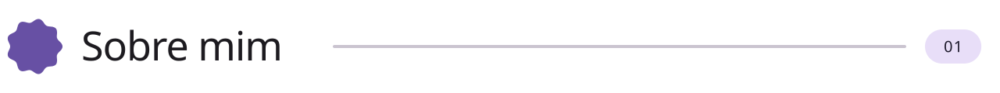
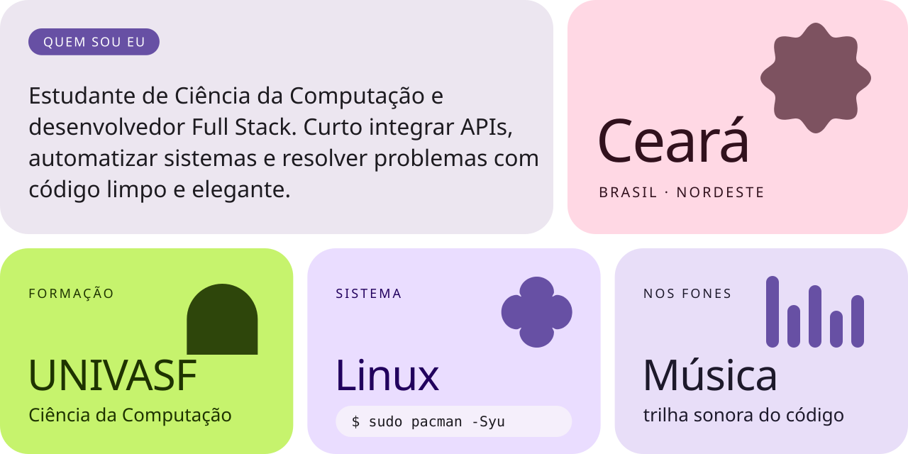
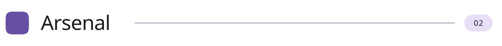
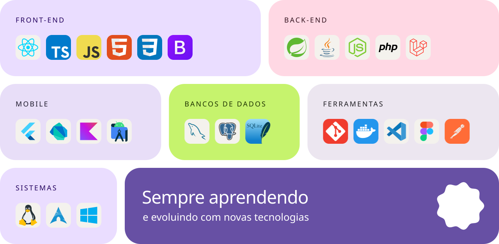
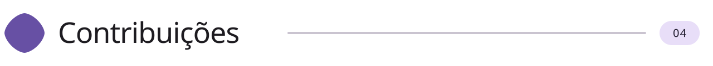
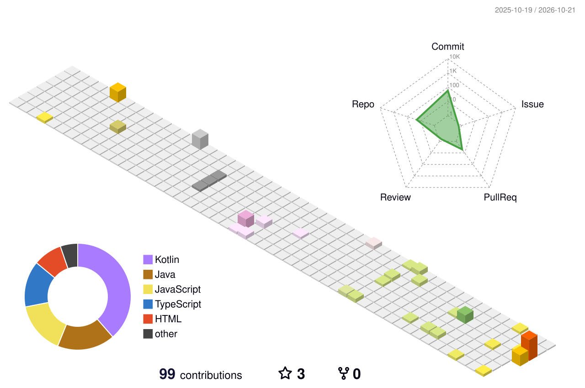
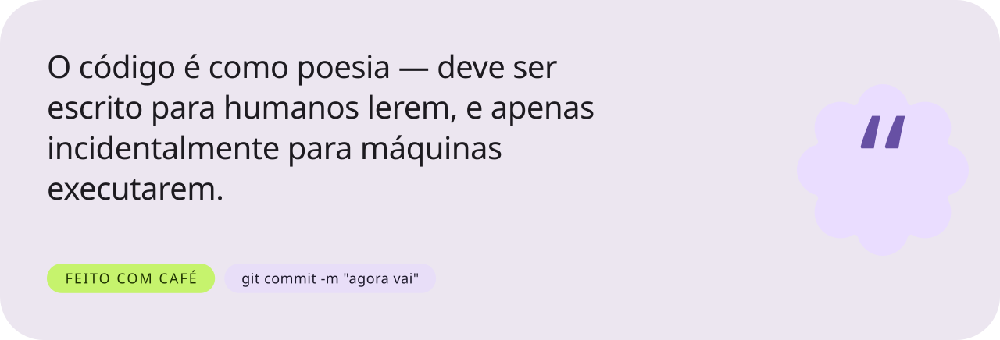

<picture>
  <source media="(prefers-color-scheme: dark)" srcset="./assets/hero-dark.svg">
  
</picture>

 

<picture>
  <source media="(prefers-color-scheme: dark)" srcset="./assets/title-sobre-dark.svg">
  
</picture>

<picture>
  <source media="(prefers-color-scheme: dark)" srcset="./assets/sobre-dark.svg">
  
</picture>

 

<picture>
  <source media="(prefers-color-scheme: dark)" srcset="./assets/title-stack-dark.svg">
  
</picture>

<picture>
  <source media="(prefers-color-scheme: dark)" srcset="./assets/stack-dark.svg">
  
</picture>

 

<picture>
  <source media="(prefers-color-scheme: dark)" srcset="./assets/title-stats-dark.svg">
  
</picture>

  <picture>
    <source media="(prefers-color-scheme: dark)" srcset="https://github-readme-stats.vercel.app/api?username=mraphaelpy&show_icons=true&include_all_commits=true&count_private=true&hide_border=true&border_radius=28&bg_color=1D1B20&title_color=D0BCFF&text_color=E6E0E9&icon_color=EFB8C8&ring_color=C6F36D&locale=pt-br&rank_icon=github">
    
  </picture>
  <picture>
    <source media="(prefers-color-scheme: dark)" srcset="https://github-readme-stats.vercel.app/api/top-langs/?username=mraphaelpy&layout=compact&langs_count=8&hide_border=true&border_radius=28&bg_color=1D1B20&title_color=D0BCFF&text_color=E6E0E9&locale=pt-br">
    
  </picture>

  <picture>
    <source media="(prefers-color-scheme: dark)" srcset="https://streak-stats.demolab.com?user=mraphaelpy&hide_border=true&border_radius=28&background=1D1B20&ring=D0BCFF&fire=EFB8C8&currStreakNum=E6E0E9&sideNums=E6E0E9&currStreakLabel=D0BCFF&sideLabels=CAC4D0&dates=CAC4D0&stroke=CAC4D0&locale=pt_BR&date_format=j%20M%5B%20Y%5D">
    
  </picture>

 

<picture>
  <source media="(prefers-color-scheme: dark)" srcset="./assets/title-3d-dark.svg">
  
</picture>

<picture>
  <source media="(prefers-color-scheme: dark)" srcset="./profile-3d-contrib/profile-night-rainbow.svg">
  
</picture>

<picture>
  <source media="(prefers-color-scheme: dark)" srcset="https://raw.githubusercontent.com/MRaphaelpy/MRaphaelpy/output/dist/snake-dark.svg">
  
</picture>

  

<picture>
  <source media="(prefers-color-scheme: dark)" srcset="./assets/title-musica-dark.svg">
  
</picture>

  

<picture>
  <source media="(prefers-color-scheme: dark)" srcset="./assets/title-contato-dark.svg">
  
</picture>

  

<picture>
  <source media="(prefers-color-scheme: dark)" srcset="./assets/footer-dark.svg">
  
</picture>

 

